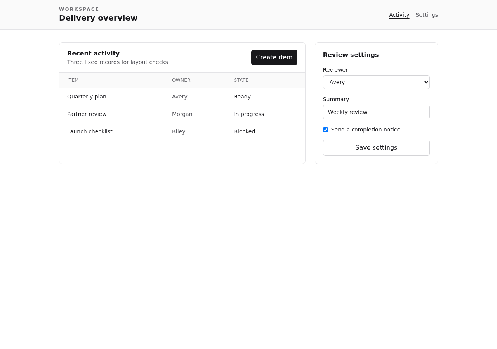
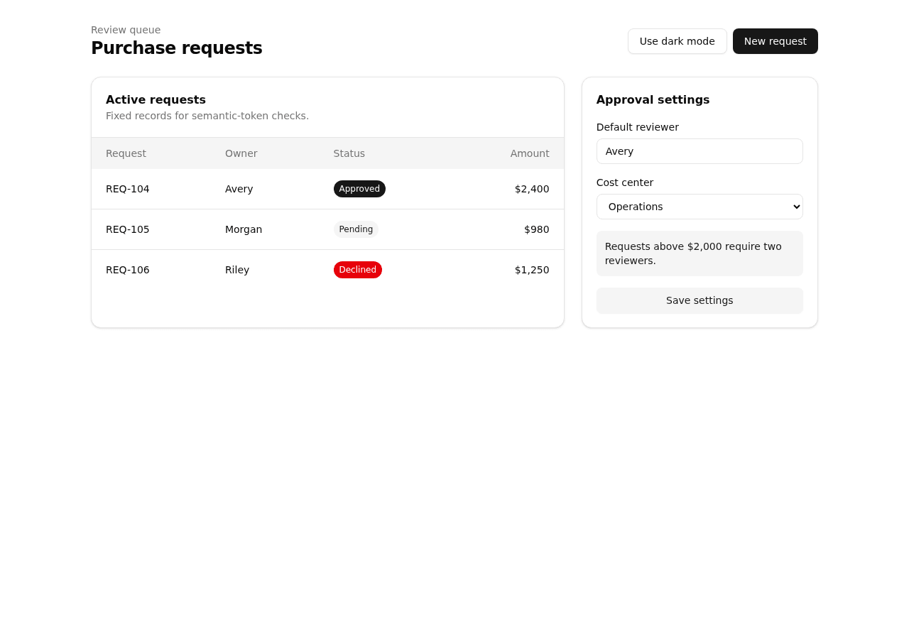
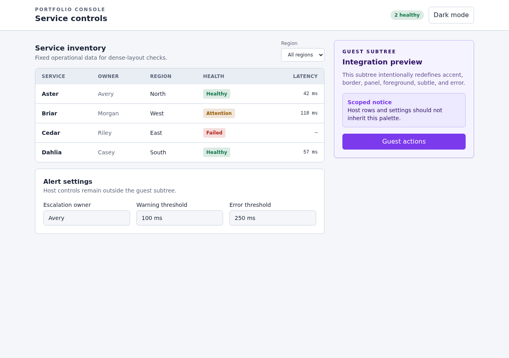
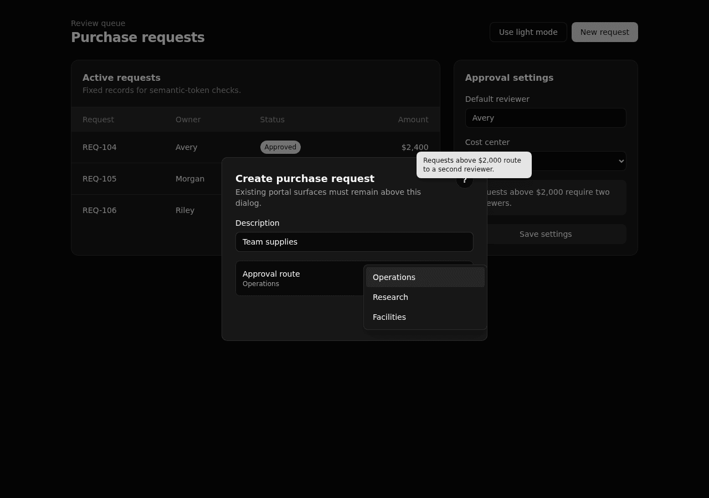
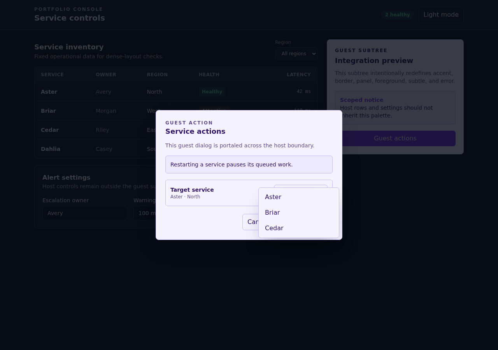

# 标准消费者测试夹具

这些确定性应用模拟了三种常见的 Tailwind v4 集成形态。截图记录的是它们的生产构建，并非黄金测试。

| 纯 Tailwind 对照组 | 既有 shadcn 风格应用 | 作用域企业风格应用 |
| --- | --- | --- |
|  |  |  |
| 一个最小 Tailwind 应用，用于捕获那些假定已有语义主题、或改变基线工具类与重置行为的设置步骤。 | 一套应用自有的语义令牌系统，用于捕获令牌冲突、模式不匹配，以及卡片、表单、状态、表格和顶层表面中的回归。 | 一份显式的颜色模式契约，宿主 UI 包裹访客子树，用于捕获应用令牌泄漏、边界故障和顶层宿主令牌漂移。 |

## 深色与交互状态

| 既有 shadcn 风格应用 | 作用域企业风格应用 |
| --- | --- |
|  |  |
| 传送门对话框使其独立传送的帮助工具提示和审批路由菜单清晰地位于背景层之上。 | 访客作用域的对话框和菜单跨越宿主边界，同时保留访客令牌及其预期的层级顺序。 |

## 刷新截图

从生产构建以 1280 × 900 渲染变更后的夹具截图，然后刷新夹具清单：

```bash
pnpm -F @astryxdesign/vibe-tests fixtures:screenshots
pnpm -F @astryxdesign/vibe-tests fixtures:refresh -- enterprise-scoped-synthetic
pnpm -F @astryxdesign/vibe-tests fixtures:verify
```

图库限制为每张 PNG 250 KiB，总计 300 KiB。